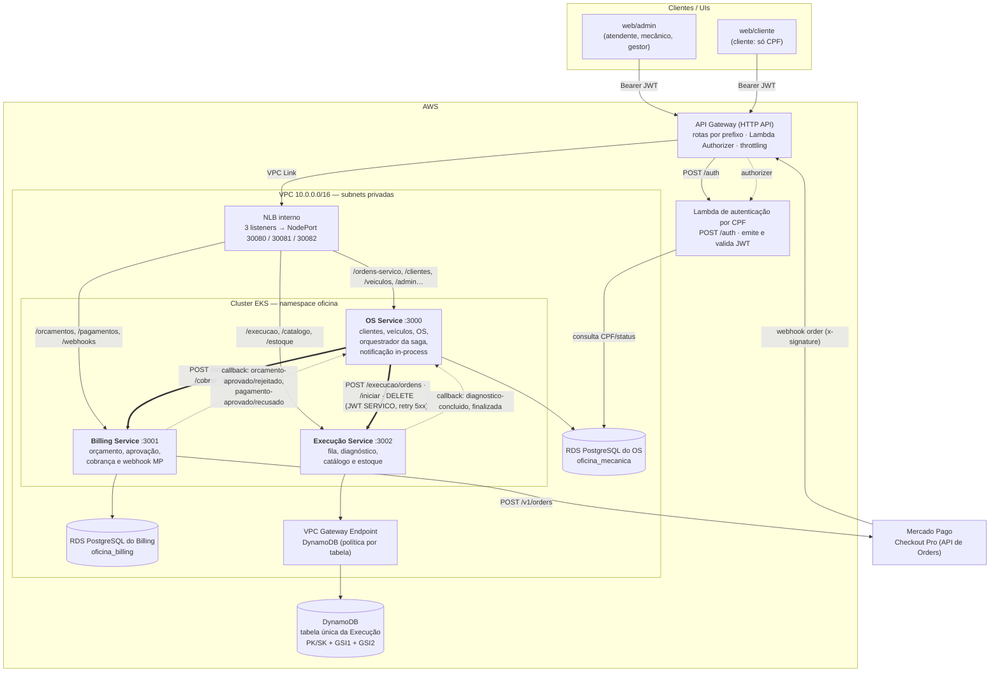
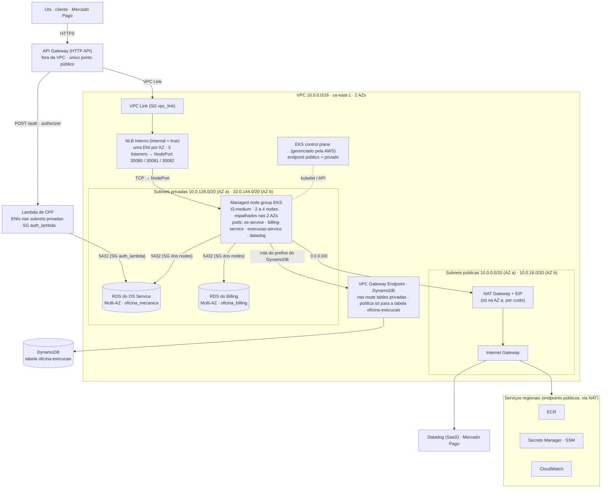
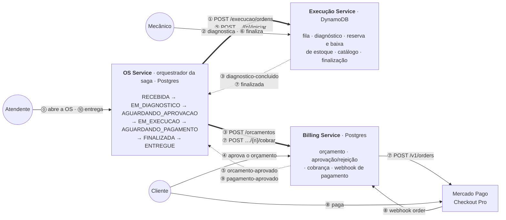
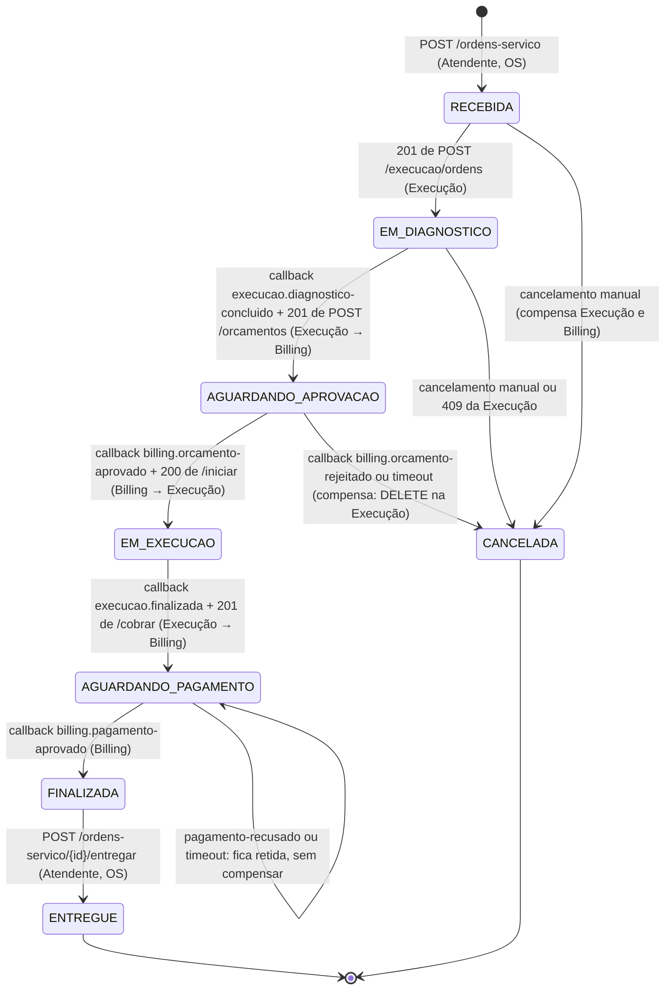
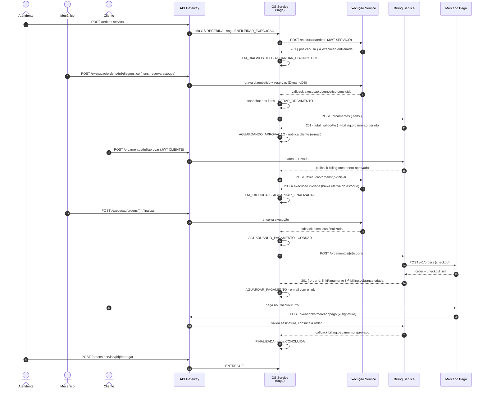
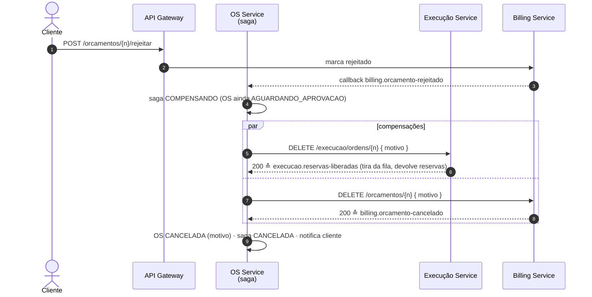
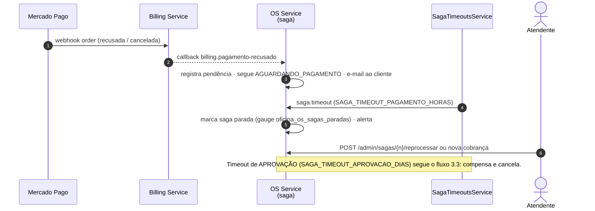
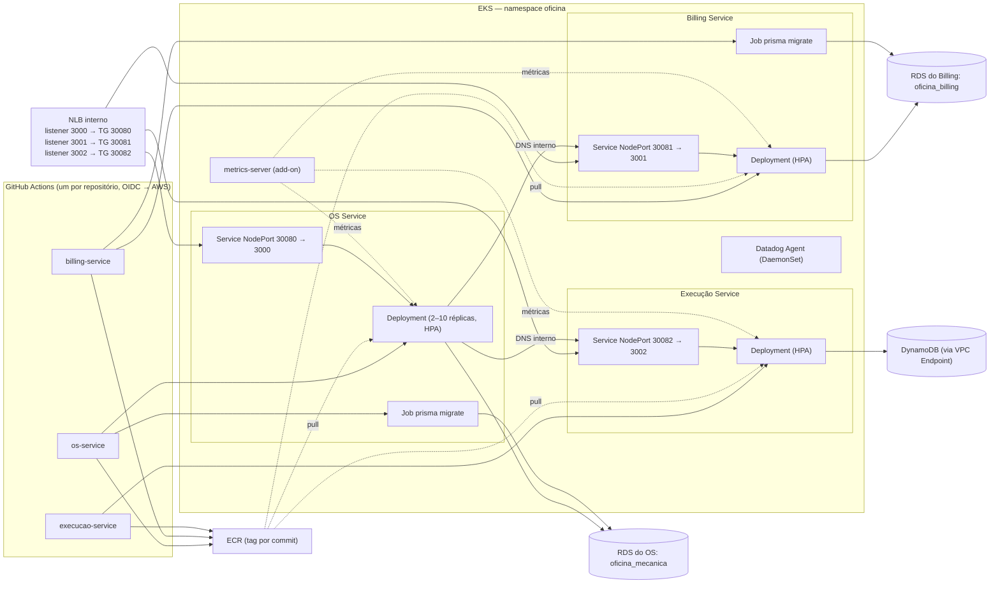

# Arquitetura — Fase 4

Desenho da arquitetura final da Fase 4: o monólito virou **três microsserviços**
(OS, Billing e Execução) que conversam por **HTTP direto com callbacks**
(RFC-0008), cada um com o **próprio banco** (duas instâncias RDS Postgres + DynamoDB), todos
atrás do **mesmo API Gateway** e orquestrados por uma **saga** que vive no OS
Service. Os diagramas estão em [Mermaid](https://mermaid.js.org/) e são
renderizados diretamente pelo GitHub. A Fase 4 é uma **evolução** da
[Arquitetura da Fase 3](arquitetura-fase3.md): a rede, o gateway e a
autenticação por CPF continuam; muda o que roda dentro do cluster e como os
pedaços se falam.

> Para o PDF e os slides, as imagens já exportadas estão em
> [`diagramas/fase4/`](diagramas/fase4/) (`01-visao-geral.png` … `08-deploy-eks.png`).
> Para regenerar após editar um bloco:
> `npx -p @mermaid-js/mermaid-cli mmdc -i docs/arquitetura/arquitetura-fase4.md -o /tmp/fase4.png -b white -s 2`
> (ou cole o bloco em <https://mermaid.live>).

Fontes de verdade: Terraform em `soat-fiap-oficina-infra-k8s` (`cluster/`,
`gateway/`, `observability/`) e `soat-fiap-oficina-infra-db`; contrato
[`docs/contratos/http-interno.md`](../contratos/http-interno.md); saga em
`src/ordem-de-servico/saga/domain/saga-os.entity.ts`.

---

## 1. Visão geral: microsserviços, bancos e comunicação

O **API Gateway é o único ponto público**. As UIs e o cliente autenticam na
Lambda de CPF e chamam os três serviços pelo mesmo host, roteados **por
prefixo** (`/ordens-servico`, `/orcamentos`, `/execucao`, ...). Entre si os
serviços **não passam pelo gateway**: o OS Service chama Execução e Billing pelo
DNS interno do cluster com um **JWT de serviço** (`role: SERVICO`) e recebe as
respostas assíncronas por **callbacks** em `POST /ordens-servico/{n}/eventos`.
O Mercado Pago entra pelo gateway num único webhook público do Billing.

**Legenda:** linha cheia = chamada síncrona do usuário; linha grossa = comando da
saga (OS → serviço, resposta imediata vira evento); pontilhada = callback.
Fora do desenho, para não poluir: **Secrets Manager** entrega o segredo do JWT,
a `DATABASE_URL` de cada serviço e as credenciais do Mercado Pago; o **agente
Datadog** no cluster recolhe traces, logs e métricas dos três serviços.

| Serviço | Repositório | Banco | O que guarda |
|---|---|---|---|
| OS Service | `soat-fiap-oficina-os-service` (este, hub de docs) | RDS próprio, Postgres `oficina_mecanica` | clientes, veículos, OS com snapshot dos itens, `saga_os`, `processed_messages`, notificações, usuários |
| Billing Service | `soat-fiap-oficina-billing-service` | RDS próprio, Postgres `oficina_billing` | orçamentos e itens, aprovação/rejeição, cobranças (order do Mercado Pago), eventos de webhook |
| Execução Service | `soat-fiap-oficina-execucao-service` | DynamoDB (tabela única, via VPC Endpoint) | fila de execução, diagnóstico, catálogo de serviços/produtos, reservas e movimentos de estoque |

---

## 2. Rede: a VPC e o caminho de uma requisição

Uma VPC `10.0.0.0/16` em **duas zonas de disponibilidade**, com uma subnet
pública e uma privada por AZ. Tudo o que executa fica nas **subnets privadas**:
nodes do EKS, NLB interno, as duas instâncias RDS e as ENIs da Lambda. O
DynamoDB é um serviço regional e não tem interface na VPC; ele é alcançado por
um **VPC Gateway Endpoint** (gratuito) nas route tables privadas, com política
restrita à tabela da Execução, sem passar pelo NAT. As subnets públicas só têm
o **Internet Gateway** e um **NAT Gateway** (um só, na primeira AZ, por custo),
por onde os nodes saem para ECR, Secrets Manager, Datadog e Mercado Pago. Não há nenhum load balancer público: a entrada é sempre o API Gateway,
que alcança o NLB pelo **VPC Link**.

Regras de segurança que importam:

- **RDS**: uma instância por serviço (ADR-0014), cada uma com o próprio security group aceitando 5432 só dos nodes (e da Lambda, no caso do OS), nunca da internet (`publicly_accessible = false`). O segredo de cada serviço só contém o próprio host.
- **DynamoDB** só é alcançado pelo VPC Gateway Endpoint, cuja política permite apenas a tabela `oficina-execucao` e seus índices; o tráfego nunca sai para a internet.
- **NLB** é `internal = true`; o target group aponta para os **nodes** (NodePort), por isso não precisa de AWS Load Balancer Controller.
- **VPC Link** tem SG próprio com saída apenas para o NLB/nodes.
- A **Lambda** fica na VPC para chegar ao RDS; sai para o Secrets Manager pelo NAT.
- As chamadas **entre serviços** nunca saem do cluster: `http://billing-service:3001`, `http://execucao-service:3002` (DNS do namespace `oficina`).

Custo: o desenho é o mínimo para alta disponibilidade do banco e do cluster
(duas AZs, RDS Multi-AZ) com um único NAT Gateway e um endpoint de gateway gratuito; o cluster fica **desligado**
fora das janelas de demo e é recriado pelo CI do `infra-k8s`.

---

## 3. O fluxo de uma OS entre os microsserviços

Numa página: a OS nasce no OS Service, vai para a fila da Execução, volta como
diagnóstico, vira orçamento no Billing, o cliente aprova, a Execução executa,
o Billing cobra no Mercado Pago, o pagamento confirma e o atendente entrega.
O OS Service é o único que **manda** (linhas grossas); os outros dois
**respondem** na hora ou **avisam depois** por callback (pontilhadas). Os
números são a ordem dos passos; o detalhe de cada um está na sequência 3.2.

Se o cliente **rejeita** (ou o prazo de aprovação vence), o OS Service chama
`DELETE /execucao/ordens/{n}` e `DELETE /orcamentos/{n}` e a OS vai para
`CANCELADA`. Se o **pagamento é recusado**, nada é desfeito: a OS fica retida em
`AGUARDANDO_PAGAMENTO` até o atendente resolver.

### 3.1 Máquina de estados e quem é o dono de cada transição

Cobrança **depois** da execução (decisão de 03/11): o cliente aprova o
orçamento, o serviço é feito, e só então nasce a cobrança no Mercado Pago.

A saga no OS Service (`saga_os`) acompanha a OS passo a passo:
`ENFILEIRAR_EXECUCAO → AGUARDAR_DIAGNOSTICO → GERAR_ORCAMENTO → AGUARDAR_APROVACAO
→ INICIAR_EXECUCAO → AGUARDAR_FINALIZACAO → COBRAR → AGUARDAR_PAGAMENTO → CONCLUIDA`.
Cada evento recebido (resposta síncrona ou callback) é aplicado numa **única
transação** com a OS; comandos para os outros serviços saem **depois do commit**
e a resposta é reinjetada como novo evento. Duplicatas são ignoradas pelo `id`
do envelope (`processed_messages`).

### 3.2 Caminho feliz

### 3.3 Compensação: cliente rejeita o orçamento

Falha de negócio **antes** da execução → a saga entra em `COMPENSANDO`, chama
os `DELETE` dos dois serviços (idempotentes) e encerra a OS como `CANCELADA`.
O mesmo caminho atende o cancelamento manual pelo atendente e o timeout de
aprovação.

### 3.4 Pagamento recusado e timeouts

Depois da execução o serviço já foi prestado, então **não há rollback**: a OS
fica retida em `AGUARDANDO_PAGAMENTO` e o atendente resolve (nova cobrança ou
baixa manual). Os timeouts são eventos internos `saga.timeout` gerados pelo
`SagaTimeoutsService`.

### 3.5 Como as chamadas são protegidas

| Mecanismo | Onde | O que garante |
|---|---|---|
| JWT de serviço (`role: SERVICO`, 50 min em cache) | kit `@guilhermeqmaia/oficina-kit/http` | só serviços chamam endpoints internos e o callback |
| Retry 3x com backoff (200/800/3000 ms) só em 5xx, timeout e erro de rede; timeout 5 s | kit `/http` | `409` de negócio vira evento de falha, nunca é repetido |
| Idempotência por `numeroOS` (serviços) e por `id` do envelope (OS) | Billing, Execução, `processed_messages` no OS | reentrega não duplica orçamento, reserva ou transição |
| Lock otimista (`version`) + retry em `ConcurrentModificationError` | OS Service | callback e resposta síncrona concorrentes não perdem transição |
| `x-correlation-id` + `traceparent` propagados | kit `/http` + Datadog APM | uma OS é um trace só atravessando os três serviços |

---

## 4. Deploy no EKS

Três `Deployment`s no namespace `oficina`, cada um com `Service` **NodePort
fixo** (é o que o target group do NLB conhece), `HPA` por CPU/memória e um `Job`
de migração (Prisma) para os dois serviços Postgres. O CI de cada repositório
faz build, testes, quality gate, publica a imagem no ECR e aplica o overlay
`k8s-aws` no cluster.

---

## 5. Onde cada decisão está registrada

| Tema | Documento |
|---|---|
| Três serviços e o que ficou em cada um | [RFC-0004](rfcs/) |
| Saga orquestrada no OS Service | [RFC-0005](rfcs/), [US-F4-10](../user-stories/f4-10-saga-orquestrada.md), [US-F4-11](../user-stories/f4-11-compensacoes-rollback.md) |
| HTTP direto + callbacks no lugar de SNS/SQS | [RFC-0008](rfcs/RFC-0008-comunicacao-http-entre-servicos.md), [`http-interno.md`](../contratos/http-interno.md) |
| DynamoDB tabela única na Execução | [RFC-0007](rfcs/) |
| Kit compartilhado e cliente HTTP interno | [ADR-0010](adr/) |
| Mercado Pago via API de Orders, cobrança após a execução | [ADR-0012](adr/ADR-0012-pagamento-mercado-pago.md) |
| Gateway único com NLB e um listener por serviço | [ADR-0013](adr/) |
| Uma instância RDS por serviço e VPC Endpoint para o DynamoDB | [ADR-0014](adr/ADR-0014-instancia-rds-por-servico-e-endpoint-dynamodb.md), [US-F4-03](../user-stories/f4-03-bancos-por-servico.md) |
