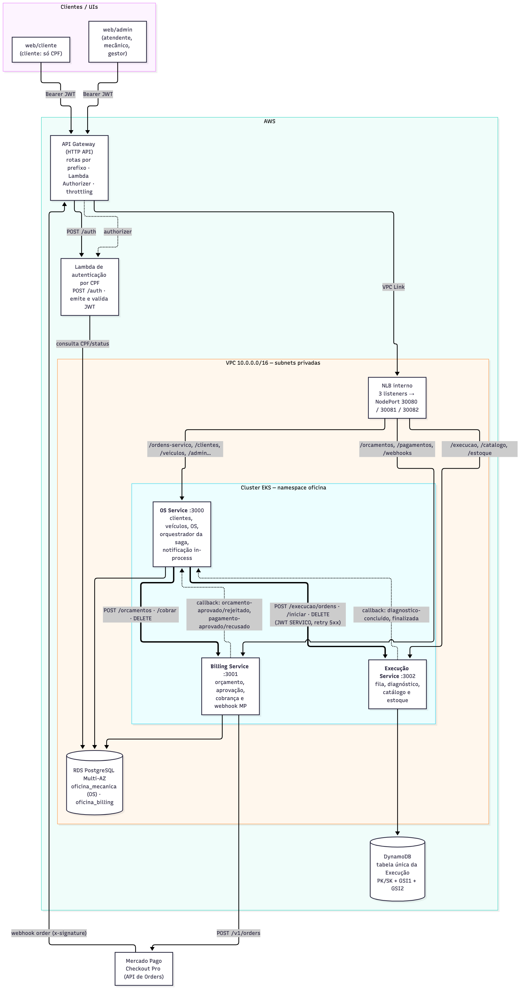

# Tech Challenge FIAP — Fase 4: Documento de Entrega

**Sistema da Oficina Mecânica** · Turma SOAT · Grupo: Guilherme Maia, Bruno Cobello, Lucas Correia, Gabriel Carneiro de Sousa

> Este documento é a fonte do **PDF único** exigido no enunciado da Fase 4.
> Os itens marcados com ⏳ dependem da sessão de demonstração na AWS (infra no ar)
> e são preenchidos antes da entrega.

---

## 1. Participantes

| Nome | GitHub | Fluxo principal na Fase 4 |
|---|---|---|
| Guilherme Maia | `guilhermeqmaia` | Fundação (kit, template, CI/CD, infra, gateway), saga orquestrada, Entrega |
| Bruno Cobello | `engineercodeprojects` | FLUXO 1 — Execução Service |
| Lucas Correia | `lucascorreiabs` | FLUXO 2 — Billing Service (orçamento + Mercado Pago) |
| Gabriel Carneiro de Sousa | `GabrielCarneiroSousa` | FLUXO 3 — OS ponta a ponta (notificações, contratos, BDD, observabilidade, SonarCloud) |

---

## 2. Repositórios (7, cada um com CI/CD e `main` protegida)

| # | Repositório | Papel | Banco |
|---|---|---|---|
| 1 | https://github.com/guilhermeqmaia/soat-fiap-oficina-os-service | **OS Service**: abertura, status, histórico, notificações e **orquestrador da saga**; hub da documentação | PostgreSQL (RDS próprio) |
| 2 | https://github.com/guilhermeqmaia/soat-fiap-oficina-billing-service | **Billing Service**: orçamento, aprovação/rejeição, cobrança no **Mercado Pago** (API de Orders + webhook), ledger | PostgreSQL (RDS próprio) |
| 3 | https://github.com/guilhermeqmaia/soat-fiap-oficina-execucao-service | **Execução Service**: fila de execução, diagnóstico, catálogo e **estoque** | **DynamoDB** (NoSQL) |
| 4 | https://github.com/guilhermeqmaia/soat-fiap-oficina-kit | Pacote npm `@guilhermeqmaia/oficina-kit` + template de serviço (auth, logs, métricas, cliente HTTP interno) | — |
| 5 | https://github.com/guilhermeqmaia/soat-fiap-oficina-infra-k8s | Terraform: VPC, EKS, API Gateway, VPC Endpoint do DynamoDB, observabilidade | — |
| 6 | https://github.com/guilhermeqmaia/soat-fiap-oficina-infra-db | Terraform: uma instância RDS por serviço + tabelas DynamoDB | — |
| 7 | https://github.com/guilhermeqmaia/soat-fiap-oficina-auth-lambda | Lambda de autenticação por CPF + authorizer do gateway (Fase 3) | — |

**Proteção da `main`:** PR obrigatório com 1 aprovação, force-push e deleção bloqueados e checagens automáticas obrigatórias. No os-service: testes, SonarCloud (quality gate), BDD e BDD ponta a ponta. No billing e na execução: lint/testes com gate de 80%, build da imagem, SonarCloud e BDD.

**Evidência de cobertura e qualidade:** SonarCloud (organização `guilhermeqmaia`) com badge no README de cada serviço:

| Serviço | SonarCloud |
|---|---|
| OS Service | https://sonarcloud.io/summary/overall?id=guilhermeqmaia_soat-fiap-oficina-os-service |
| Billing Service | https://sonarcloud.io/summary/overall?id=guilhermeqmaia_soat-fiap-oficina-billing-service |
| Execução Service | https://sonarcloud.io/summary/overall?id=guilhermeqmaia_soat-fiap-oficina-execucao-service |

**Swagger / OpenAPI:** `/api` em cada serviço fora de produção. Os contratos versionados estão em [`docs/contratos/openapi/`](contratos/openapi/README.md), e o contrato HTTP interno em [`docs/contratos/http-interno.md`](contratos/http-interno.md).

---

## 3. Vídeo (≤ 15 min)

⏳ **Link:** _a publicar (YouTube não listado)_

O roteiro está na [seção 8](#8-roteiro-do-vídeo-15-min).

---

## 4. Arquitetura final

- **Entrada única:** API Gateway (HTTP API) com a Lambda de CPF (Fase 3). Rotas por prefixo levam a um NLB interno com um listener por serviço: `/ordens-servico|/clientes|/veiculos|/usuario|/notificacoes|/admin` → OS, `/orcamentos|/pagamentos|/webhooks` → Billing, `/execucao|/catalogo` → Execução.
- **Comunicação entre serviços:** HTTP direto pelo DNS interno do cluster (`oficina-app:3000`, `oficina-billing-service:3001`, `oficina-execucao-service:3002`), nunca pelo gateway. Comandos do orquestrador são chamadas síncronas, com timeout de 5 s e 3 tentativas com backoff. Participantes avisam o OS por **callback** (`POST /ordens-servico/{numero}/eventos`). Autenticação entre serviços por JWT de serviço (`role: SERVICO`). Ver [RFC-0008](arquitetura/rfcs/RFC-0008-comunicacao-http-entre-servicos.md).
- **Bancos:** um por serviço, isolados por instância e por rede. São duas instâncias RDS PostgreSQL, uma do OS e uma do Billing, e o DynamoDB da Execução, acessado pelo VPC Gateway Endpoint com política restrita às tabelas `oficina-*` ([ADR-0014](arquitetura/adr/ADR-0014-instancia-rds-por-servico-e-endpoint-dynamodb.md)). Nenhum serviço acessa o banco de outro.
- **Observabilidade (da Fase 3, estendida):** Datadog com APM, logs JSON correlacionados (`x-correlation-id` = número da OS, `traceparent` propagado em toda chamada e callback), dashboard "Oficina — Fluxo distribuído" e alertas da saga (saga parada, retry esgotado, 5xx por serviço, latência entre serviços).

Diagramas detalhados (rede, máquina de estados, caminho feliz, compensação, pagamento recusado, deploy): [`arquitetura/arquitetura-fase4.md`](arquitetura/arquitetura-fase4.md).

---

## 5. Saga Pattern: estratégia escolhida

**Saga orquestrada**, com o orquestrador no OS Service ([RFC-0005](arquitetura/rfcs/RFC-0005-estrategia-de-saga.md)). O estado da saga fica na tabela `saga_os` e pode ser consultado em `GET /ordens-servico/numero/{numero}/saga`.

| Passo | Comando / evento | Participante |
|---|---|---|
| `ENFILEIRAR_EXECUCAO` | `execucao.enfileirar` → OS em `EM_DIAGNOSTICO` | Execução |
| `AGUARDAR_DIAGNOSTICO` | callback `execucao.diagnostico-concluido` (peças baixadas do estoque) | Execução |
| `GERAR_ORCAMENTO` | `billing.gerar-orcamento` → OS em `AGUARDANDO_APROVACAO` | Billing |
| `AGUARDAR_APROVACAO` | callback `billing.orcamento-aprovado` / `-rejeitado` (cliente) | Billing |
| `INICIAR_EXECUCAO` | `execucao.iniciar` → OS em `EM_EXECUCAO` | Execução |
| `AGUARDAR_FINALIZACAO` | callback `execucao.finalizada` | Execução |
| `COBRAR` | `billing.cobrar` (order no Mercado Pago) → OS em `AGUARDANDO_PAGAMENTO` | Billing |
| `AGUARDAR_PAGAMENTO` | callback `billing.pagamento-aprovado` → OS em `FINALIZADA` | Billing |

**Rollback e compensação:**
- **Falha de negócio antes da execução** (veículo já em execução, orçamento rejeitado, prazo de aprovação vencido, cancelamento pelo atendente): a saga entra em `COMPENSANDO` e envia `billing.cancelar-orcamento` e `execucao.liberar-reservas`. A Execução devolve ao estoque as peças baixadas no diagnóstico, de forma idempotente. A OS termina `CANCELADA` com o motivo.
- **Falha técnica** (participante fora do ar, timeout): retry com backoff. Se as tentativas se esgotam, a saga fica parada no passo, o alerta `oficina_os_sagas_paradas` dispara e o operador usa `POST /admin/sagas/{numero}/reprocessar` ([runbook](runbooks/saga-reprocessar.md)). Para a demo, o header `x-simular-falha` injeta a falha num passo.
- **Pagamento recusado** (depois do serviço executado) não desfaz nada: a OS fica retida em `AGUARDANDO_PAGAMENTO` até o pagamento, sem estorno.
- **Idempotência em tudo:** comandos por `numeroOS`; callbacks pelo `id` do envelope (`processed_messages`); movimentações de estoque com id determinístico; cobrança com idempotency key no Mercado Pago.

**Por que orquestração:** o fluxo tem 8 passos e compensações que cruzam serviços. Com orquestração, o estado fica **explícito, consultável e testável**, e o "rastreamento dos fluxos distribuídos" pedido no vídeo sai direto da tabela da saga e dos traces. Com coreografia, as compensações ficariam implícitas, espalhadas pelos consumidores. As notificações ao cliente continuam coreografadas: o módulo de notificação só reage aos fatos da saga.

---

## 6. Justificativa da divisão e das tecnologias

**Divisão em 3 microsserviços** ([RFC-0004](arquitetura/rfcs/RFC-0004-decomposicao-em-microsservicos.md)): segue os exemplos do enunciado e os bounded contexts do nosso Event Storming.
- **OS Service** (Atendimento: cliente, veículo, OS, histórico, notificações e a saga). Nasceu do monólito das fases anteriores pelo padrão *strangler*.
- **Billing Service** (orçamento, pagamento, ledger). É onde há dinheiro, por isso banco relacional e ledger append-only.
- **Execução Service** (fila, diagnóstico, catálogo e estoque). Catálogo e Estoque ficam aqui porque é o mecânico quem escolhe serviços e peças no diagnóstico. Separá-los em outros serviços dobraria o custo de infra sem ganho para o domínio.

| Tecnologia | Por quê |
|---|---|
| NestJS + TypeScript, DDD por módulo | Continuidade das fases 1–3; mesmo kit e template nos 3 serviços |
| PostgreSQL (RDS, uma instância por serviço) | Transações ACID para OS e dinheiro; isolamento sem ambiguidade |
| DynamoDB (Execução) | NoSQL exigido; execução é um documento por OS; estoque com *conditional writes* e `TransactWriteItems` (saldo nunca negativo) |
| HTTP direto + callbacks (sem broker) | Decisão do time em 03/11 ([RFC-0008](arquitetura/rfcs/RFC-0008-comunicacao-http-entre-servicos.md)). Saga orquestrada com 3 participantes no mesmo cluster, depuração com `curl` e traces HTTP, sem outbox/DLQ/LocalStack. A resiliência que a fila daria vem de retry + idempotência + reprocessar. O SNS/SQS FIFO avaliado antes ficou como histórico ([RFC-0006](arquitetura/rfcs/RFC-0006-mensageria.md)) |
| Mercado Pago (API de Orders, sandbox) | Exigência do enunciado; webhook assinado (HMAC) e reconciliação periódica |
| `@guilhermeqmaia/oficina-kit` | Auth (resource server + JWT de serviço), logs, métricas, health e cliente HTTP interno iguais nos 3 serviços ([ADR-0010](arquitetura/adr/README.md)) |
| Kubernetes (EKS) + API Gateway + Terraform | Infra da Fase 3 reaproveitada; deploy automatizado por serviço (GitHub Actions → ECR → EKS) |
| SonarCloud | "SonarQube ou similar" sem hospedar servidor; quality gate no CI ([ADR-0011](arquitetura/adr/README.md)) |
| Cucumber + Gherkin (pt-BR) | BDD por serviço e um fluxo completo ponta a ponta no os-service (`features/e2e/ciclo-completo-os.feature`) |
| Datadog | Observabilidade da Fase 3, estendida com métricas e alertas da saga |

---

## 7. Checklist do enunciado

- [x] 3 microsserviços, cada um com repositório, infraestrutura e banco próprios
- [x] Um banco relacional (PostgreSQL) e um não relacional (DynamoDB); nenhum serviço acessa o banco de outro
- [x] Saga Pattern orquestrado com rollback/compensação; escolha documentada (README do os-service + RFC-0005)
- [x] Testes unitários nos 3 serviços; cobertura ≥ 80% por serviço (SonarCloud)
- [x] BDD: um `.feature` por serviço + fluxo completo ponta a ponta
- [x] SonarCloud no CI com quality gate
- [x] Pipeline independente por serviço: build, testes, qualidade e deploy no Kubernetes
- [x] `main` protegida com PR obrigatório e checagens automáticas
- [x] Dockerfile e manifestos Kubernetes em cada serviço; Swagger/OpenAPI
- [x] Observabilidade da Fase 3 (Datadog) estendida ao fluxo distribuído
- [ ] Comunicação por mensageria: **substituída por HTTP + callbacks** (decisão justificada na RFC-0008; ver seção 6)
- [ ] ⏳ Deploy ativo na AWS e URLs preenchidas (seção 9)
- [ ] ⏳ Vídeo publicado

---

## 8. Roteiro do vídeo (≤ 15 min)

| Tempo | Bloco | O que mostrar |
|---|---|---|
| 0:00–1:30 | Arquitetura | Diagrama da seção 4; 3 serviços, bancos, gateway, saga orquestrada |
| 1:30–5:30 | **Fluxo completo de uma OS** | Atendente abre a OS pelo gateway → Execução enfileira → mecânico atribui, vincula serviços/peças e conclui o diagnóstico (estoque baixa) → Billing gera o orçamento → cliente aprova → execução → finalizar → cobrança no Mercado Pago (link do sandbox) → pagamento aprovado → `FINALIZADA` → entrega. Mostrar `GET .../saga` em cada passo |
| 5:30–8:30 | **Saga e tratamento de falhas** | (a) Orçamento rejeitado → `COMPENSANDO` → estoque devolvido (`GET /execucao/ordens/{n}/movimentacoes`) → OS `CANCELADA`. (b) Falha injetada com `x-simular-falha` → retry esgotado → alerta de saga parada → `POST /admin/sagas/{n}/reprocessar` → saga retoma. (c) Pagamento recusado → OS retida sem rollback |
| 8:30–11:30 | **Deploy automatizado com testes** | PR em um serviço → checks obrigatórios (testes, SonarCloud, BDD) → merge → `cd-aws` → imagem no ECR → rollout no EKS (`kubectl rollout status`) |
| 11:30–14:30 | **Monitoramento e rastreamento** | Datadog: trace de uma OS atravessando OS → Execução → Billing (mesmo `x-correlation-id`), dashboard "Fluxo distribuído", logs correlacionados, monitor de saga parada |
| 14:30–15:00 | Encerramento | Links dos repositórios e do PDF |

---

## 9. Preparação da demo (checklist operacional)

1. `caffeinate -i scripts/aws-deploy-all.sh --profile oficina` no infra-k8s (~30 min): cluster, RDS ×2, DynamoDB, Lambda, gateway, observabilidade e os 3 serviços.
2. Billing: secret JSON no Secrets Manager apontado por `MP_SECRET_ID` (`MP_ACCESS_TOKEN`, `MP_WEBHOOK_SECRET`, `MP_PAYER_EMAIL`, credenciais de teste do card FLUXO 2), `MP_RETORNO_BASE_URL` com a URL do gateway e o webhook do painel do Mercado Pago apontando para `{gateway}/webhooks/mercadopago`.
3. Variáveis `EKS_CLUSTER_NAME` nos repos do Billing e da Execução (o deploy no EKS só liga com ela).
4. Seeds de demonstração (catálogo, estoque, cliente, veículo, usuários).
5. Validar cenários M2–M7 do sandbox com o webhook público.
6. Gravar; depois `scripts/aws-pause.sh` ou `aws-destroy-all.sh --yes`.

| Componente | URL |
|---|---|
| API Gateway | ⏳ output `api_base_url` |
| Dashboard "Fluxo distribuído" (Datadog) | ⏳ |
| Dashboard técnico (Datadog) | ⏳ |
